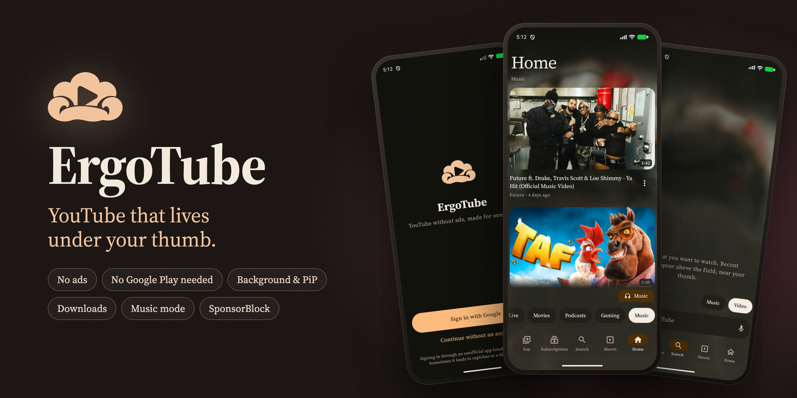
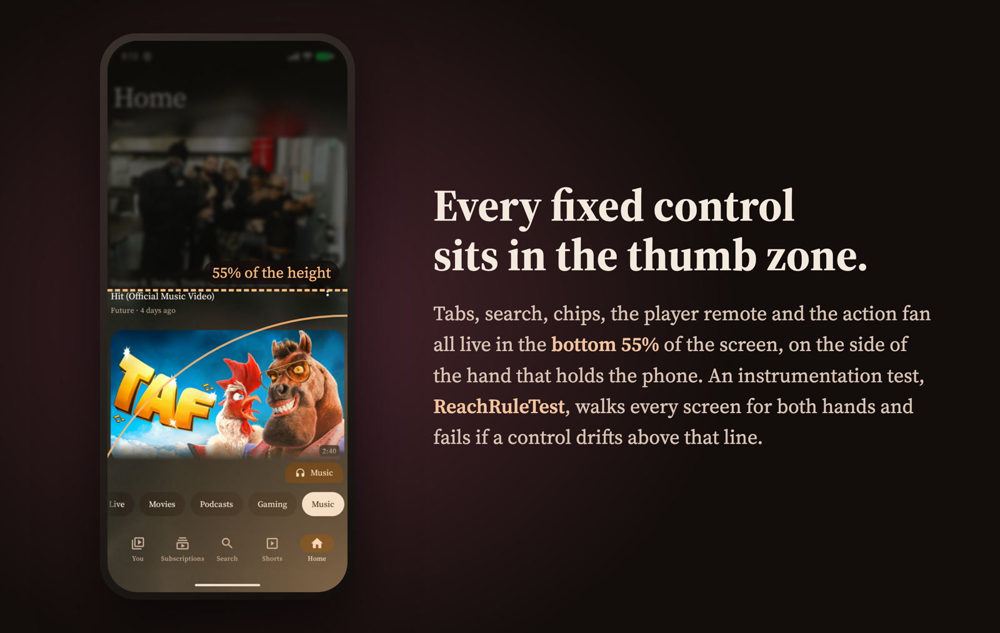
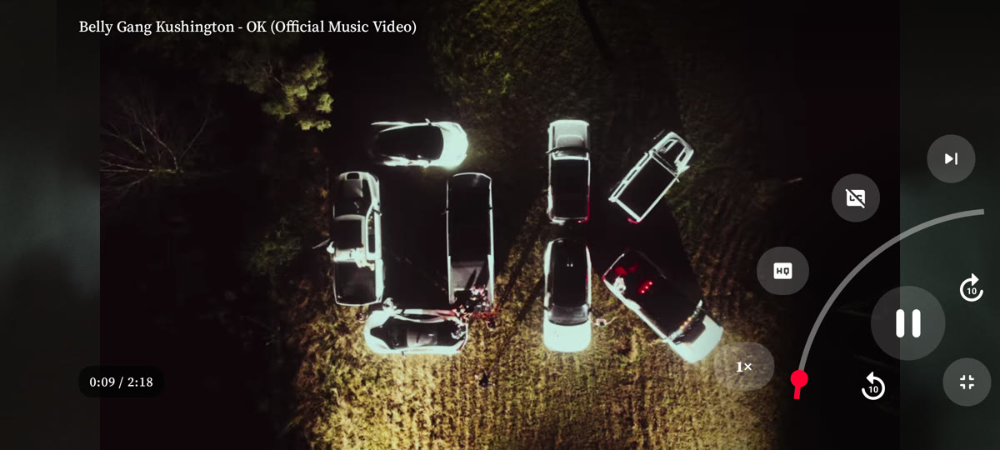

<div align="center">



<h3>An Android YouTube client built around one thumb.</h3>

<p>
<a href="https://github.com/aeonist/ergotube/releases/latest"></a>
<a href="LICENSE"></a>

</p>
<p>


</p>

**English** · [Русский](README.ru.md)

<a href="https://github.com/aeonist/ergotube/releases/latest"><b>⬇ Download the latest APK</b></a> · <a href="#features">Features</a> · <a href="#why-its-good">Why</a> · <a href="#how-it-compares">Compare</a> · <a href="#install">Install</a> · <a href="#build-from-source">Build</a> · <a href="#support-the-project">Donate</a> · <a href="CHANGELOG.md">Changelog</a>

</div>

---

Most YouTube apps, the official one and the open-source ones, keep search, tabs and menus at the top of the screen. On a tall phone held in one hand, your thumb can't reach them.

ErgoTube puts them at the bottom. Tabs, search, filters, the player controls and the actions for each video sit in the lower half of the screen, on the side of the hand that holds the phone. You can sign in with a Google account without Google Play Services or microG, or skip the account entirely. There are no ads, and you get background play, downloads, a music mode, and a soft glow around the video that takes its colors from the picture.


<table>
<tr>
<td valign="top" width="33%">

### The action fan

Press and hold a video card and six actions open around your finger: Later, Download, Save, Share, Not interested and Listen. Slide toward one and let go. You never have to find a small three-dot button.

</td>
<td valign="top" width="33%">

### The player

In portrait the video stays on top and the controls sit under your thumb: play, ±10 s (taps add up), hold for 2× speed, and a timeline that gets more precise as you move your finger up. Turn the phone sideways and the controls move into a fan in the corner.

</td>
<td valign="top" width="33%">

### Motion

Menus and panels fade in and out of a blur instead of sliding. The background picks up light from the video you are watching, and in music mode it pulses with the song.

</td>
</tr>
</table>



<p align="center"><br><sub>In fullscreen the controls sit in a fan in the corner, and you seek by sweeping your thumb along the arc.</sub></p>

## Why it's good

**Extremely flexible.**
Right hand or left hand, and the whole layout mirrors. Lists read top to bottom or bottom to top. Five themes, two languages, and a classic YouTube layout for anyone who misses the old ways. If ErgoTube were any more flexible it would need a yoga mat.

**Fast.**
Clients built on NewPipeExtractor make seven requests to YouTube, one after another, before a video can start. ErgoTube makes one short one, which takes about 0.3 seconds. The lookup begins the moment your finger touches a card, and the next Short starts loading while you are still swiping, so it plays 0.2 seconds after you let go. We haven't measured it against the speed of light yet, but we're optimistic.

**The best design known to mankind.**
The background takes its light from the video. Menus come into focus out of a blur instead of sliding in. Every button you use often is in the bottom half of the screen, and a test fails the build if one drifts up. Several historians are said to be reconsidering the Renaissance.

**Made for the thumb you actually have.**
Search, tabs, filters, the player controls and the action fan are all where your thumb already is. You can watch an entire evening of videos without ever doing the two-handed phone shuffle. Doctors hate this one trick (citation needed).

**Private.**
ErgoTube has no servers, no analytics and no account of its own. Your cookies go to YouTube and nowhere else. We don't know who you are, and we'd like to keep it that way.

**Free, with no ads.**
No ads, no subscription, no trial. The code is GPL, so it stays open. The only thing ErgoTube costs you is the habit of reaching for the top of the screen.

**Light on data.**
On phones with a hardware VP9 decoder ErgoTube picks VP9 first, which uses about a third less data than H.264 at the same quality. Your mobile plan will send a thank-you card.

**Tested.**
More than 230 automated tests check the YouTube parsers, the player maths, the layout and the reach rule for both hands. That is more tests than most people have had hot dinners this week.

## Features

<table>
<tr>
<td valign="top" width="50%">

**One-handed use**
- Hand-side dock: You, Subscriptions, Search, Shorts, Home. Mirror it for the left hand.
- Every fixed control in the bottom half of the screen, checked by `ReachRuleTest` for both hands.
- No on-screen Back buttons; use the system Back gesture or the dock.
- Search, chips and channel strips at the bottom edge; lists can read bottom-up.
- Optional classic layout that places buttons the way YouTube does.

**Watching**
- Background playback, picture-in-picture and a floating mini-player you drag to any corner.
- Precise seeking in fullscreen: the timeline zooms in on a short part of the video and moves slower than your finger.
- Quality palettes with separate Wi-Fi and mobile limits, speed, captions, loop, sleep timer.
- Pinch to zoom in portrait and fullscreen; tabletop and unfolded layouts on foldables.
- SponsorBlock with segments on the timeline, DeArrow titles and thumbnails, Return YouTube Dislike.

</td>
<td valign="top" width="50%">

**With or without an account**
- Google sign-in in the app: recommendations, subscriptions, history, playlists, comments, likes.
- No account: local subscriptions with background RSS checks and new-video notifications.
- Careful mode asks before actions on your main account, so a stray tap doesn't like or subscribe.

**Music**
- A Listen page with your mixes, a player that takes its colors from the cover, synced lyrics and a queue.
- One library for YouTube songs and the music files on your phone.
- Downloaded songs are saved with tags in `Music/ErgoTube`. The background pulses to the beat without asking for microphone access.

**Downloads**
- Download any video, Short or song. The queue survives restarts and supports pause, resume and retry.
- Thumbnails, captions and descriptions are saved too, so downloads play offline.

**Appearance**
- Light, dark, system and AMOLED themes, a classic YouTube dark theme, English and Russian.

</td>
</tr>
</table>

## How it compares

NewPipe and LibreTube are good YouTube clients. ErgoTube differs mainly in layout: everything is reachable with one thumb.

| | **ErgoTube** | NewPipe | LibreTube |
|---|:---:|:---:|:---:|
| Every control in the thumb zone | ✅ | — | — |
| Hold-and-flick card actions | ✅ | — | — |
| Sign in with a Google account, no microG | ✅ | — | — |
| Use without any account | ✅ | ✅ | ✅ |
| Background play and picture-in-picture | ✅ | ✅ | ✅ |
| Downloads and offline playback | ✅ | ✅ | ✅ |
| SponsorBlock | ✅ | — | ✅ |
| Music mode with lyrics | ✅ | — | — |

<sub>Based on the standard builds of each app as of November 2026. Forks may add more.</sub>

## Install

1. Open [Releases](https://github.com/aeonist/ergotube/releases/latest) on your phone and download `ErgoTube-buildNN-release.apk`.
2. Open the file. Android asks to allow installs from this source; allow it.
3. Android 8.0 (API 26) or newer is required. No Google Play Services needed.

The app shows a banner when a new release is published here.

> [!WARNING]
> Signing in through any unofficial client breaks YouTube's Terms of Service. Google may show captchas, limit access for a while or suspend the account. The risk is small, but use a spare account rather than your main one, or use ErgoTube without signing in.

## Privacy

ErgoTube has no servers and collects no data. Account cookies are encrypted with a key in the Android Keystore and are sent only to `youtube.com` and `googlevideo.com`. Cloud backup of app data is turned off. The only other network calls are the optional SponsorBlock, DeArrow and Return YouTube Dislike lookups, song lyrics from LRCLIB, and the update check against this repository's releases.

## Build from source

You need JDK 21 and the Android SDK with platform `android-37.0` and build-tools 37 (through Android Studio or `sdkmanager`). Point Gradle at the SDK with `sdk.dir=…` in `local.properties` or `ANDROID_HOME`.

```bash
./gradlew assembleDebug           # app/build/outputs/apk/debug/app-debug.apk
./gradlew testDebugUnitTest       # 200+ JVM tests
./gradlew lintDebug
./gradlew connectedDebugAndroidTest   # instrumentation tests, needs an emulator or a phone
```

Debug builds install as `app.ergotube.debug` next to a release build. `./gradlew assembleRelease` makes a minified release; without your own `keystore.properties` it is signed with the debug key, which is fine for personal use.

InnerTube parsers are tested against saved responses in `app/src/test/resources/innertube`. Automated tests never sign in to a personal account.

## Project structure

```
app/src/main/java/app/freshtuber/
├── innertube/    own InnerTube client: signed requests, cookie rotation, parsers
├── player/       Media3 playback service, stream resolver, PiP, music player, audio pulse
├── data/         account, feeds, downloads, music library, subscriptions, settings, updates
├── background/   WorkManager jobs: downloads, RSS checks, notifications
├── core/         Hilt modules, networking, NewPipe bridge, Keystore encryption
├── domain/       plain models shared by every layer
└── ui/           Compose screens, liquid-light shaders, blur motion, dock and fan
```

Kotlin, Jetpack Compose, Material 3, Hilt, Room, DataStore, WorkManager, Media3 (ExoPlayer), OkHttp, Coil and [NewPipeExtractor](https://github.com/TeamNewPipe/NewPipeExtractor) for anonymous streams. The package is still `app.freshtuber`, the project's working name; the installed app id is `app.ergotube`.

Product and technical decisions are recorded in [`docs/DECISIONS.md`](docs/DECISIONS.md). Start at [`docs/README.md`](docs/README.md) for a map of the docs, and at [`CONTRIBUTING.md`](CONTRIBUTING.md) if you want to help.

## Support the project

ErgoTube is free. If you'd like to support it:

<p>
<a href="https://app.lava.top/2097792502?tabId=donate"></a>
</p>

USDT (send only USDT, and only on the network named):

- TON: `UQCE_gE_8LGNM9_8WztoWQcTSqRh3E2uY9CrTstU5IOIv_R2`
- TRON (TRC20): `TUzoKgYS74SmxA32a9hqkiPrTyfFKtRaxC`

The same options are in the app under Settings → Support the author.

## Thanks

Formats and ideas were checked against [NewPipe](https://github.com/TeamNewPipe/NewPipe), [LibreTube](https://github.com/libre-tube/LibreTube), [Metrolist](https://github.com/mostafaalagamy/Metrolist), [yt-dlp](https://github.com/yt-dlp/yt-dlp) and [YouTube.js](https://github.com/LuanRT/YouTube.js). Segment data comes from [SponsorBlock](https://sponsor.ajay.app), titles from [DeArrow](https://dearrow.ajay.app), dislikes from [Return YouTube Dislike](https://returnyoutubedislike.com), lyrics from [LRCLIB](https://lrclib.net).

## License

[GNU GPL v3.0](LICENSE) with an author attribution term under section 7(b), described in [NOTICE](NOTICE). You may use, change and share the code, but every copy and every modified version must keep the credit **"Based on ErgoTube by aeonist (https://github.com/aeonist/ergotube)"** in its source, its README and the About section of the app, and modified versions must say they were changed.

Copyright © 2026 aeonist.

<sub>ErgoTube is an independent project and is not affiliated with YouTube or Google. YouTube is a trademark of Google LLC.</sub>
