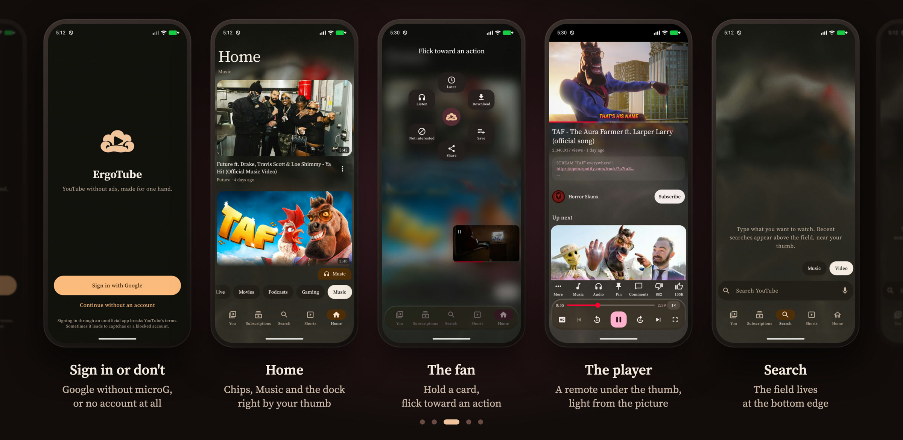

<div align="center">


<h3>An Android YouTube client built around one thumb.</h3>

<p>
<a href="https://github.com/aeonist/ergotube/releases/latest"></a>
<a href="LICENSE"></a>

</p>
<p>


</p>

**English** · [Русский](README.ru.md)

<a href="https://github.com/aeonist/ergotube/releases/latest"><b>⬇ Download the latest APK</b></a> · <a href="#features">Features</a> · <a href="#why-ergotube">Why</a> · <a href="#install">Install</a> · <a href="#build-from-source">Build</a> · <a href="CHANGELOG.md">Changelog</a>

</div>

---

Phones got taller. Thumbs did not. Every YouTube app, official or open source, still puts search, tabs and menus at the top of the screen, where your thumb can't reach without a second hand.

**ErgoTube moves all of it down.** Tabs, search, filters, the player remote and every card action sit in the lower half of the screen, on the side of the hand that holds the phone. You can sign in with your Google account without Google Play Services or microG, or use it with no account at all. No ads, background play, downloads, a full music mode, and a soft light that the video throws onto the screen around it.



<table>
<tr>
<td valign="top" width="33%">

### Hold, flick, done

Press and hold any video card and a fan of actions opens under your finger: **Later, Download, Save, Share, Not interested, Listen**. Flick toward one and let go. No three-dot menu, no reaching.

</td>
<td valign="top" width="33%">

### A remote, not a toolbar

The portrait player keeps the picture on top and a remote under your thumb: play, ±10 s (taps add up), hold for 2×, and a timeline that gets finer as your finger moves up. Turn the phone and the controls gather into a fan in the corner.

</td>
<td valign="top" width="33%">

### Calm by design

Everything that appears or hides comes into focus out of a blur. Nothing slides across the screen. The background takes its light from the picture you are watching, and in music mode it breathes with the song.

</td>
</tr>
</table>


<p align="center"><br><sub><b>Fullscreen</b>: the controls gather in a fan in the corner, and the timeline is an arc you sweep with your thumb</sub></p>

## Features

<table>
<tr>
<td valign="top" width="50%">

**🖐 Made for one hand**
- Hand-side dock: You, Subscriptions, Search, Shorts, Home. Mirror it for the left hand.
- Every fixed control in the bottom half of the screen, checked by `ReachRuleTest` for both hands.
- No on-screen Back buttons: the system gesture and the dock are enough.
- Search, chips and channel strips at the bottom edge; lists can read bottom-up.
- Optional classic layout that places buttons the way YouTube does.

**▶ Watching**
- Background playback, picture-in-picture and a floating mini-player you drag to any corner.
- Precise fullscreen seek: the timeline zooms to a short stretch of the video and glides slower than your finger.
- Quality palettes with separate Wi-Fi and mobile limits, speed, captions, loop, sleep timer.
- Pinch to zoom in portrait and fullscreen; tabletop and unfolded layouts on foldables.
- SponsorBlock with segments on the timeline, DeArrow titles and thumbnails, Return YouTube Dislike.

</td>
<td valign="top" width="50%">

**👤 Your account, or none**
- Google sign-in in the app: recommendations, subscriptions, history, playlists, comments, likes.
- No account: local subscriptions with background RSS checks and new-video notifications.
- Careful mode guards your main account against accidental actions.

**🎧 Music mode**
- «Listen» page with your jams, a player lit by the cover, synced lyrics, a three-layer queue.
- One library for YouTube songs and the music files on your phone.
- Downloads land as tagged files in `Music/ErgoTube`; the light pulses to the beat without a microphone permission.

**⬇ Downloads and offline**
- Download any video, Short or song into a persistent queue with pause, resume and retry.
- Artwork, captions and metadata stay on the phone, so downloads play with no network.

**🎨 Look**
- Light, dark, system and AMOLED themes, a classic YouTube dark theme, English and Russian.

</td>
</tr>
</table>

## Why ErgoTube

There are excellent open YouTube clients. ErgoTube is not trying to replace them; it answers one question they don't: *what if the whole app were reachable with one thumb?*

| | **ErgoTube** | NewPipe | LibreTube |
|---|:---:|:---:|:---:|
| Every control in the thumb zone | ✅ | — | — |
| Hold-and-flick card actions | ✅ | — | — |
| Sign in with a Google account, no microG | ✅ | — | — |
| Use without any account | ✅ | ✅ | ✅ |
| Background play and picture-in-picture | ✅ | ✅ | ✅ |
| Downloads and offline playback | ✅ | ✅ | ✅ |
| SponsorBlock | ✅ | — | ✅ |
| Music mode with lyrics | ✅ | — | — |

<sub>Compared against the upstream apps' default builds in November 2026. Forks add their own features.</sub>

## Install

1. Open **[Releases](https://github.com/aeonist/ergotube/releases/latest)** on your phone and download `ErgoTube-buildNN-release.apk`.
2. Open the file. Android asks to allow installs from this source; allow it.
3. Android 8.0 (API 26) or newer is required. No Google Play Services needed.

The app tells you itself when a newer release appears here.

> [!WARNING]
> **About your account.** Signing in through any unofficial client breaks YouTube's Terms of Service. Google may show captchas, limit access for a while or suspend the account. The risk is small but real, so **use a spare account, not your main one**, or use ErgoTube without signing in.

## Privacy

ErgoTube has no servers and collects nothing. Account cookies are encrypted with a key in the Android Keystore and are sent only to `youtube.com` and `googlevideo.com`. Cloud backup of app data is turned off. The only other network calls are the optional SponsorBlock, DeArrow and Return YouTube Dislike lookups, song lyrics from LRCLIB, and the update check against this repository's releases.

## Build from source

You need JDK 21 and the Android SDK with platform `android-37.0` and build-tools 37 (through Android Studio or `sdkmanager`). Point Gradle at the SDK with `sdk.dir=…` in `local.properties` or `ANDROID_HOME`.

```bash
./gradlew assembleDebug           # app/build/outputs/apk/debug/app-debug.apk
./gradlew testDebugUnitTest       # 200+ JVM tests
./gradlew lintDebug
./gradlew connectedDebugAndroidTest   # instrumentation tests, needs an emulator or a phone
```

Debug builds install as `app.ergotube.debug` next to a release build. `./gradlew assembleRelease` makes a minified release; without your own `keystore.properties` it is signed with the debug key, which is fine for personal use.

InnerTube parsers are tested against saved responses in `app/src/test/resources/innertube`. Automated tests never sign in to a personal account.

## Under the hood

```
app/src/main/java/app/freshtuber/
├── innertube/    own InnerTube client: signed requests, cookie rotation, parsers
├── player/       Media3 playback service, stream resolver, PiP, music player, audio pulse
├── data/         account, feeds, downloads, music library, subscriptions, settings, updates
├── background/   WorkManager jobs: downloads, RSS checks, notifications
├── core/         Hilt modules, networking, NewPipe bridge, Keystore encryption
├── domain/       plain models shared by every layer
└── ui/           Compose screens, liquid-light shaders, blur motion, dock and fan
```

Kotlin, Jetpack Compose, Material 3, Hilt, Room, DataStore, WorkManager, Media3 (ExoPlayer), OkHttp, Coil and [NewPipeExtractor](https://github.com/TeamNewPipe/NewPipeExtractor) for anonymous streams. The package is still `app.freshtuber`, the project's working name; the installed app id is `app.ergotube`.

Every product and technical decision is written down in [`docs/DECISIONS.md`](docs/DECISIONS.md). Start at [`docs/README.md`](docs/README.md) for a map of the docs, and at [`CONTRIBUTING.md`](CONTRIBUTING.md) if you want to help.

## Support

ErgoTube is free and will stay free. If it saves your thumb, **Settings → Support the author** lets you say thanks by card, PayPal or USDT.

## Thanks

Formats and ideas were checked against [NewPipe](https://github.com/TeamNewPipe/NewPipe), [LibreTube](https://github.com/libre-tube/LibreTube), [Metrolist](https://github.com/mostafaalagamy/Metrolist), [yt-dlp](https://github.com/yt-dlp/yt-dlp) and [YouTube.js](https://github.com/LuanRT/YouTube.js). Segment data comes from [SponsorBlock](https://sponsor.ajay.app), titles from [DeArrow](https://dearrow.ajay.app), dislikes from [Return YouTube Dislike](https://returnyoutubedislike.com), lyrics from [LRCLIB](https://lrclib.net).

## License

[GNU GPL v3.0](LICENSE) with an author attribution term under section 7(b), described in [NOTICE](NOTICE). You may use, change and share the code, but every copy and every modified version must keep the credit **"Based on ErgoTube by aeonist (https://github.com/aeonist/ergotube)"** in its source, its README and the About section of the app, and modified versions must say they were changed.

Copyright © 2026 aeonist.

<sub>ErgoTube is an independent project. It is not affiliated with, endorsed by or connected to YouTube or Google. YouTube is a trademark of Google LLC.</sub>
