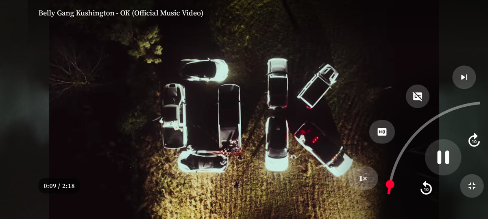

<div align="center">


<h3>Клиент YouTube для Android, которым удобно пользоваться одной рукой.</h3>

<p>
<a href="https://github.com/aeonist/ergotube/releases/latest"></a>
<a href="LICENSE"></a>

</p>

[English](README.md) · **Русский**

<a href="https://github.com/aeonist/ergotube/releases/latest"><b>⬇ Скачать последнюю версию</b></a> · <a href="#возможности">Возможности</a> · <a href="#установка">Установка</a> · <a href="#сборка-из-исходников">Сборка</a> · <a href="#поддержать-проект">Поддержать</a> · <a href="CHANGELOG.md">Что нового</a>

</div>

---

Почти все приложения YouTube, и официальное, и открытые, держат поиск, вкладки и меню вверху экрана. На длинном телефоне большим пальцем туда не дотянуться.

В ErgoTube всё это внизу. Вкладки, поиск, фильтры, кнопки плеера и действия с видео находятся в нижней половине экрана, со стороны руки, которая держит телефон. Можно войти в аккаунт Google без Google Play Services и microG или пользоваться без аккаунта. Рекламы нет, есть фоновое воспроизведение, скачивание, музыкальный режим и мягкая подсветка вокруг видео в цветах картинки.


<table>
<tr>
<td>

### Веер действий

Зажми карточку видео, и вокруг пальца появятся шесть действий: Позже, Скачать, Сохранить, Поделиться, Не интересует и Слушать. Сдвинь палец к нужному и отпусти. Искать маленькую кнопку с тремя точками не нужно.

### Плеер

В вертикальном режиме видео сверху, а кнопки под большим пальцем: пауза, ±10 секунд (нажатия складываются), удержание для скорости 2× и перемотка, которая становится точнее, если вести палец выше. Если повернуть телефон, кнопки соберутся веером в нижнем углу.

### Анимация

Меню и панели появляются и исчезают через размытие, а не выезжают сбоку. Фон подсвечивается цветами видео, а в музыкальном режиме пульсирует в такт песне.

</td>
</tr>
</table>

<p align="center"><br><sub>В полном экране кнопки собраны веером в углу, а перематывать можно, ведя пальцем по дуге.</sub></p>

## Почему это хорошо

**Невероятно гибкое.**
Правая рука или левая, и вся раскладка зеркалится. Ленты читаются сверху вниз или снизу вверх. Пять тем, два языка и классический вид YouTube для тех, кто скучает по старому. Ещё немного гибкости, и приложению понадобится коврик для йоги.

**Быстрое.**
Клиенты на основе NewPipeExtractor делают семь запросов к YouTube подряд, прежде чем видео сможет начаться. ErgoTube делает один короткий, это около 0,3 секунды. Поиск видео начинается в момент касания карточки, а следующий Shorts грузится, пока ты ещё листаешь, и играет через 0,2 секунды после того, как ты отпустил палец. Со скоростью света мы пока не сравнивали, но настроены оптимистично.

**Лучший дизайн в истории человечества.**
Фон подсвечивается цветами видео. Меню проявляются из размытия, а не выезжают сбоку. Все частые кнопки в нижней половине экрана, и если какая-то уползёт выше, тест не даст собрать приложение. Говорят, несколько историков уже пересматривают эпоху Возрождения.

**Под твой большой палец.**
Поиск, вкладки, фильтры, кнопки плеера и веер действий там, где палец уже лежит. Можно смотреть видео весь вечер и ни разу не перехватывать телефон второй рукой. Врачи ненавидят этот трюк (источник не найден).

**Приватное.**
У ErgoTube нет серверов, нет аналитики и нет своих аккаунтов. Cookies уходят только в YouTube и больше никуда. Мы не знаем, кто ты, и хотим, чтобы так и оставалось.

**Бесплатное и без рекламы.**
Без рекламы, без подписки, без пробного периода. Код под GPL, поэтому он останется открытым. Единственное, чего тебе будет стоить ErgoTube, это привычки тянуться к верху экрана.

**Экономит трафик.**
Если в телефоне есть аппаратный декодер VP9, ErgoTube выбирает его первым: это примерно на треть меньше трафика, чем H.264 при том же качестве. Мобильный оператор пришлёт открытку с благодарностью.

**Проверенное.**
Больше 230 автоматических тестов проверяют разбор ответов YouTube, математику плеера, раскладку и правило досягаемости для обеих рук. Это больше тестов, чем у некоторых самолётов. Наверное.

## Возможности

**Под одну руку**
- Нижняя панель у рабочей руки: Моё, Подписки, Поиск, Shorts, Главная. Для левой руки она зеркалится.
- Все постоянные кнопки в нижней половине экрана; это проверяет тест `ReachRuleTest` для обеих рук.
- На экранах нет кнопок «Назад», для этого есть системный жест и нижняя панель.
- Поиск, фильтры и полоска каналов у нижнего края, ленты можно читать снизу вверх.
- По желанию классический вид, где кнопки стоят как в YouTube.

**Просмотр**
- Фон, картинка в картинке и плавающий мини-плеер, который перетаскивается в любой угол.
- Точная перемотка в полном экране: шкала приближается к короткому отрезку и идёт медленнее пальца.
- Качество с отдельными пределами для Wi-Fi и мобильной сети, скорость, субтитры, повтор, таймер сна.
- Увеличение двумя пальцами; на раскладушках отдельные раскладки для книжки и «ноутбука».
- SponsorBlock с отрезками на шкале, названия и обложки DeArrow, дизлайки Return YouTube Dislike.

**С аккаунтом или без**
- Вход в Google прямо в приложении: рекомендации, подписки, история, плейлисты, комментарии, лайки.
- Без аккаунта: подписки на телефоне, фоновая проверка новых видео и уведомления.
- Осторожный режим спрашивает подтверждение перед действиями с основным аккаунтом, чтобы случайное нажатие не поставило лайк или подписку.

**Музыка**
- Страница «Слушать» с миксами, плеер в цветах обложки, синхронные тексты песен и очередь.
- Одна библиотека для песен с YouTube и музыкальных файлов на телефоне.
- Скачанные песни сохраняются с тегами в `Music/ErgoTube`. Фон пульсирует в ритм без доступа к микрофону.

**Скачивание**
- Можно скачать любое видео, Shorts или песню. Очередь переживает перезапуск, загрузку можно поставить на паузу, продолжить или повторить.
- Обложки, субтитры и описания тоже сохраняются, поэтому скачанное играет без интернета.

**Оформление**
- Светлая, тёмная, системная и AMOLED-темы, классическая тёмная тема YouTube, русский и английский язык.

## Сравнение

NewPipe и LibreTube хорошие клиенты YouTube. Главное отличие ErgoTube в раскладке: до всего можно достать одним большим пальцем.

| | **ErgoTube** | NewPipe | LibreTube |
|---|:---:|:---:|:---:|
| Все кнопки в зоне большого пальца | ✅ | — | — |
| Веер действий по удержанию карточки | ✅ | — | — |
| Вход в аккаунт Google без microG | ✅ | — | — |
| Работа без аккаунта | ✅ | ✅ | ✅ |
| Фон и картинка в картинке | ✅ | ✅ | ✅ |
| Скачивание и офлайн | ✅ | ✅ | ✅ |
| SponsorBlock | ✅ | — | ✅ |
| Музыкальный режим с текстами | ✅ | — | — |

<sub>По обычным сборкам этих приложений на ноябрь 2026 года. В форках может быть больше.</sub>

## Установка

1. Открой на телефоне [страницу релизов](https://github.com/aeonist/ergotube/releases/latest) и скачай `ErgoTube-buildNN-release.apk`.
2. Открой файл. Android попросит разрешить установку из этого источника, разреши.
3. Нужен Android 8.0 или новее. Google Play Services не нужны.

Когда здесь выходит новая версия, приложение показывает об этом баннер.

> [!WARNING]
> Вход через любой неофициальный клиент нарушает условия YouTube. Google может показывать капчи, на время ограничить доступ или заблокировать аккаунт. Риск небольшой, но лучше входить запасным аккаунтом, а не основным, или пользоваться без входа.

## Приватность

У ErgoTube нет своих серверов, приложение ничего не собирает. Cookies аккаунта зашифрованы ключом из Android Keystore и уходят только на `youtube.com` и `googlevideo.com`. Резервное копирование в облако выключено. Кроме этого приложение обращается только к SponsorBlock, DeArrow и Return YouTube Dislike (всё отключается), к LRCLIB за текстами песен и к релизам этого репозитория за обновлениями.

## Сборка из исходников

Нужны JDK 21 и Android SDK с платформой `android-37.0` и build-tools 37. Путь к SDK укажи в `local.properties` (`sdk.dir=…`) или в `ANDROID_HOME`.

```bash
./gradlew assembleDebug           # app/build/outputs/apk/debug/app-debug.apk
./gradlew testDebugUnitTest       # больше 200 JVM-тестов
./gradlew lintDebug
./gradlew connectedDebugAndroidTest   # тесты на эмуляторе или телефоне
```

Отладочная сборка ставится как `app.ergotube.debug` рядом с обычной. Устройство проекта описано в [английском README](README.md#project-structure), все решения в [`docs/DECISIONS.md`](docs/DECISIONS.md), как помочь проекту в [`CONTRIBUTING.md`](CONTRIBUTING.md).

## Поддержать проект

ErgoTube бесплатная. Если хочешь поддержать автора:

<p>
<a href="https://pay.cloudtips.ru/p/2a226afa"></a>
</p>

USDT (отправляй только USDT и только в указанной сети):

- TON: `UQCE_gE_8LGNM9_8WztoWQcTSqRh3E2uY9CrTstU5IOIv_R2`
- TRON (TRC20): `TUzoKgYS74SmxA32a9hqkiPrTyfFKtRaxC`

Те же способы есть в приложении: Настройки → Поддержать автора.

## Лицензия

[GNU GPL v3.0](LICENSE) с дополнительным условием об указании автора по разделу 7(b), см. [NOTICE](NOTICE). Код можно использовать, менять и распространять, но в каждой копии и изменённой версии нужно сохранить строку **«Based on ErgoTube by aeonist (https://github.com/aeonist/ergotube)»**: в исходниках, в README и в разделе «О приложении». Изменённые версии должны указывать, что они изменены.

Copyright © 2026 aeonist.

<sub>ErgoTube не связан с YouTube и Google. YouTube является товарным знаком Google LLC.</sub>
