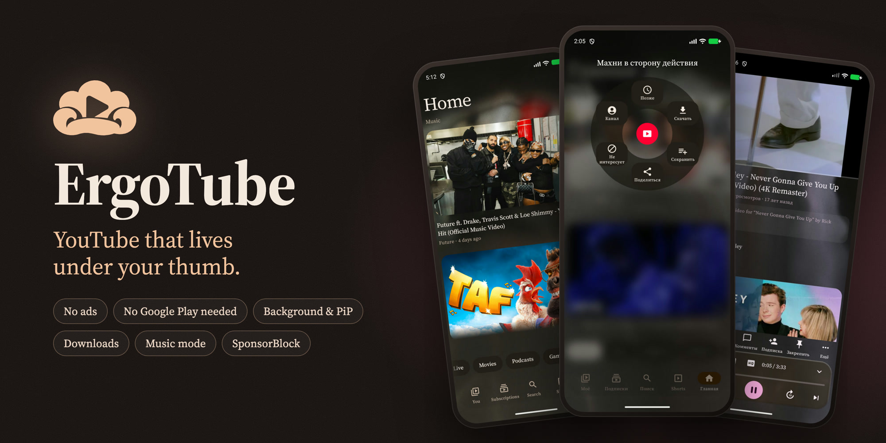
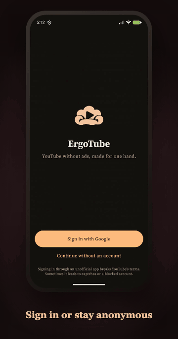

<div align="center">



<h3>Клиент YouTube для Android, который целиком помещается под большой палец.</h3>

<p>
<a href="https://github.com/aeonist/ergotube/releases/latest"></a>
<a href="LICENSE"></a>

</p>

[English](README.md) · **Русский**

<a href="https://github.com/aeonist/ergotube/releases/latest"><b>⬇ Скачать последнюю версию</b></a> · <a href="#возможности">Возможности</a> · <a href="#установка">Установка</a> · <a href="#сборка-из-исходников">Сборка</a> · <a href="CHANGELOG.md">Что нового</a>

</div>

---

Телефоны стали длиннее, а пальцы нет. Все приложения YouTube, и официальное, и открытые, по-прежнему держат поиск, вкладки и меню вверху экрана, куда одной рукой не дотянуться.

**ErgoTube переносит всё это вниз.** Вкладки, поиск, фильтры, пульт плеера и действия с карточками лежат в нижней половине экрана, со стороны руки, которая держит телефон. Можно войти в свой аккаунт Google без Google Play Services и microG, а можно пользоваться вовсе без аккаунта. Без рекламы, с фоновым воспроизведением, скачиванием, полноценным музыкальным режимом и мягким светом, который видео бросает на экран вокруг себя.

<table>
<tr>
<td width="38%" align="center"></td>
<td>

### Зажал, махнул, готово

Зажми любую карточку видео, и под пальцем раскроется веер: **Позже, Скачать, Сохранить, Поделиться, Не интересует, Канал**. Махни в сторону нужного и отпусти. Отпустишь в центре, и ничего не произойдёт. Никаких трёх точек и никаких потягиваний.

### Пульт, а не панель

В вертикальном плеере картинка сверху, а пульт под большим пальцем: пауза, ±10 секунд (нажатия складываются), удержание для 2×, перемотка, которая становится точнее, если вести палец выше. Повернёшь телефон, и кнопки соберутся веером в нижнем углу.

### Спокойно

Всё, что появляется и исчезает, проявляется из размытия. Ничего не выезжает и не прыгает. Фон берёт свет от того, что ты смотришь, а в музыкальном режиме дышит в такт песне.

</td>
</tr>
</table>

## Возможности

**🖐 Под одну руку**
- Нижняя панель у рабочей руки: Моё, Подписки, Поиск, Shorts, Главная. Для левой руки она зеркалится.
- Все постоянные кнопки ниже 55% высоты экрана; это проверяет тест `ReachRuleTest` для обеих рук.
- На экранах нет кнопок «Назад»: хватает системного жеста и нижней панели.
- Поиск, фильтры и полоска каналов у нижнего края, ленты можно читать снизу вверх.
- По желанию классический вид, где кнопки стоят как в YouTube.

**▶ Просмотр**
- Фон, картинка в картинке и плавающий мини-плеер, который перетаскивается в любой угол.
- Точная перемотка в полном экране: шкала приближается к короткому отрезку и идёт медленнее пальца.
- Качество с отдельными пределами для Wi-Fi и мобильной сети, скорость, субтитры, повтор, таймер сна.
- Увеличение двумя пальцами; на раскладушках отдельные раскладки для книжки и «ноутбука».
- SponsorBlock с отрезками на шкале, названия и обложки DeArrow, дизлайки Return YouTube Dislike.

**👤 С аккаунтом или без**
- Вход в Google прямо в приложении: рекомендации, подписки, история, плейлисты, комментарии, лайки.
- Без аккаунта: подписки на телефоне, фоновая проверка новых видео и уведомления.
- Осторожный режим защищает основной аккаунт от случайных действий.

**🎧 Музыка**
- Страница «Слушать» с джемами, плеер со светом от обложки, тексты песен в такт, очередь из трёх слоёв.
- Одна библиотека для песен с YouTube и музыкальных файлов на телефоне.
- Скачанное сохраняется с тегами в `Music/ErgoTube`; свет пульсирует в ритм без доступа к микрофону.

**⬇ Скачивание**
- Любое видео, Shorts или песню в очередь с паузой, продолжением и повтором.
- Обложки, субтитры и описания хранятся на телефоне, скачанное играет без сети.

**🎨 Вид**
- Светлая, тёмная, системная и AMOLED-темы, классическая тёмная тема YouTube, русский и английский язык.

## Чем отличается

| | **ErgoTube** | NewPipe | LibreTube |
|---|:---:|:---:|:---:|
| Все кнопки в зоне большого пальца | ✅ | — | — |
| Веер действий по удержанию карточки | ✅ | — | — |
| Вход в аккаунт Google без microG | ✅ | — | — |
| Работа без аккаунта | ✅ | ✅ | ✅ |
| Фон и картинка в картинке | ✅ | ✅ | ✅ |
| Скачивание и офлайн | ✅ | ✅ | ✅ |
| SponsorBlock | ✅ | — | ✅ |
| Музыкальный режим с текстами | ✅ | — | — |

<sub>Сравнение с обычными сборками этих приложений на ноябрь 2026 года. В форках бывает больше.</sub>

## Установка

1. Открой на телефоне **[страницу релизов](https://github.com/aeonist/ergotube/releases/latest)** и скачай `ErgoTube-buildNN-release.apk`.
2. Открой файл. Android попросит разрешить установку из этого источника, разреши.
3. Нужен Android 8.0 или новее. Google Play Services не нужны.

О новой версии приложение скажет само.

> [!IMPORTANT]
> **Если у тебя стояла старая ErgoTube.** Начиная со сборки 35 приложение называется `app.ergotube` и подписано своим ключом. Android ставит его рядом со старым `app.freshtuber`, а не поверх. Войди заново, а старое приложение удали вручную. Дальше все сборки будут обновляться как обычно.

> [!WARNING]
> **Про аккаунт.** Вход через любой неофициальный клиент нарушает условия YouTube. Google может показывать капчи, на время ограничить доступ или заблокировать аккаунт. Риск небольшой, но он есть, поэтому **входи запасным аккаунтом, а не основным**, или пользуйся без входа.

## Приватность

У ErgoTube нет своих серверов, приложение ничего не собирает. Cookies аккаунта зашифрованы ключом из Android Keystore и уходят только на `youtube.com` и `googlevideo.com`. Резервное копирование в облако выключено. Кроме этого приложение обращается только к SponsorBlock, DeArrow и Return YouTube Dislike (всё отключается), к LRCLIB за текстами песен и к релизам этого репозитория за обновлениями.

## Сборка из исходников

Нужны JDK 21 и Android SDK с платформой `android-37.0` и build-tools 37. Путь к SDK укажи в `local.properties` (`sdk.dir=…`) или в `ANDROID_HOME`.

```bash
./gradlew assembleDebug           # app/build/outputs/apk/debug/app-debug.apk
./gradlew testDebugUnitTest       # больше 200 JVM-тестов
./gradlew lintDebug
./gradlew connectedDebugAndroidTest   # тесты на эмуляторе или телефоне
```

Отладочная сборка ставится как `app.ergotube.debug` рядом с обычной. Подробности устройства проекта в [английском README](README.md#under-the-hood), все решения в [`docs/DECISIONS.md`](docs/DECISIONS.md), как помочь проекту в [`CONTRIBUTING.md`](CONTRIBUTING.md).

## Поддержать

ErgoTube бесплатна и такой останется. Если она бережёт твой палец, в **Настройки → Поддержать автора** есть способы сказать спасибо из России и из-за границы.

## Лицензия

[GNU GPL v3.0](LICENSE) с дополнительным условием об указании автора по разделу 7(b), см. [NOTICE](NOTICE). Код можно использовать, менять и распространять, но в каждой копии и изменённой версии нужно сохранить строку **«Based on ErgoTube by aeonist (https://github.com/aeonist/ergotube)»**: в исходниках, в README и в разделе «О приложении». Изменённые версии должны указывать, что они изменены.

Copyright © 2026 aeonist.

<sub>ErgoTube не связан с YouTube и Google. YouTube является товарным знаком Google LLC.</sub>
